 

# MOHAMMED PATEL

### `mohammedpatel2024@github:~$ whoami`

**Data Analyst | Python Developer | IT Enthusiast**

*Turning data into insights, one query at a time.*

[Portfolio](https://resplendent-paletas-16f0c7.netlify.app/) · [LinkedIn](https://www.linkedin.com/in/mohammed-patel--/) · [Instagram](https://www.instagram.com/mohammed_patel_art/)

---

### `$ cat about_me.txt`

Hi! I'm **Mohammed Patel**, a tech enthusiast and aspiring Data Analyst from Mumbai, India.

- 🎓 MCA Student | Mumbai University Graduate
- 📊 Interested in Data Analytics and Data Science
- 🐍 Working with Python, SQL and Power BI
- 📈 Love exploring data and building dashboards
- 🚀 Always learning, building and improving.

### `$ ls tech_stack/`

| Category | Technologies |
|---|---|
| Languages | Python, SQL, JavaScript |
| Data Analysis | Excel, Pandas, NumPy |
| Visualization | Power BI, Matplotlib |
| Web Development | HTML, CSS, JavaScript |
| Database | MySQL, SQLite |
| Tools | Git, GitHub, VS Code |

### `$ ./featured_projects.sh`

**01. Rapido Analytics Dashboard**

Data analysis and visualization project focused on ride-booking insights.

**02. Amazon Sales Dashboard**

An interactive dashboard exploring sales performance and business insights.

**03. Spotify Web Project**

A frontend web development project inspired by Spotify.

**04. Multiple Disease Prediction System**

An academic AI/ML project using machine learning and image classification.

*Add your actual repository links to each project title.*

### `$ ./github_stats.sh`

### `$ ./connect.sh`

[🌐 Portfolio](https://resplendent-paletas-16f0c7.netlify.app/) · [💼 LinkedIn](https://www.linkedin.com/in/mohammed-patel--/) · [📸 Instagram](https://www.instagram.com/mohammed_patel_art/)

**Let's connect, collaborate and build something meaningful.**

`echo "Thanks for visiting my profile!"`

