<h1 align="center">Patel Mohammed</h1>

Title · Data Analyst · It Geek

  <a href="https://resplendent-paletas-16f0c7.netlify.app/">Portfolio</a> ·
  <a href="https://www.linkedin.com/in/mohammed-patel--/">LinkedIn</a> ·
  <a href="https://www.instagram.com/mohammed_patel_art/">Instagram</a>

<!-- Replace these placeholders with the generated assets when the template scripts are available. -->
<table align="center">
  <tr>
    <td align="center" valign="middle">
      <!-- Portrait SVG (target display width: 370px) -->
      
    </td>
    <td align="center" valign="middle">
      <!-- Wordmark SVG (target display width: 490px) -->
      
    </td>
  </tr>
</table>

  <!-- Contribution animation: replace with the generated graph asset. -->
  

